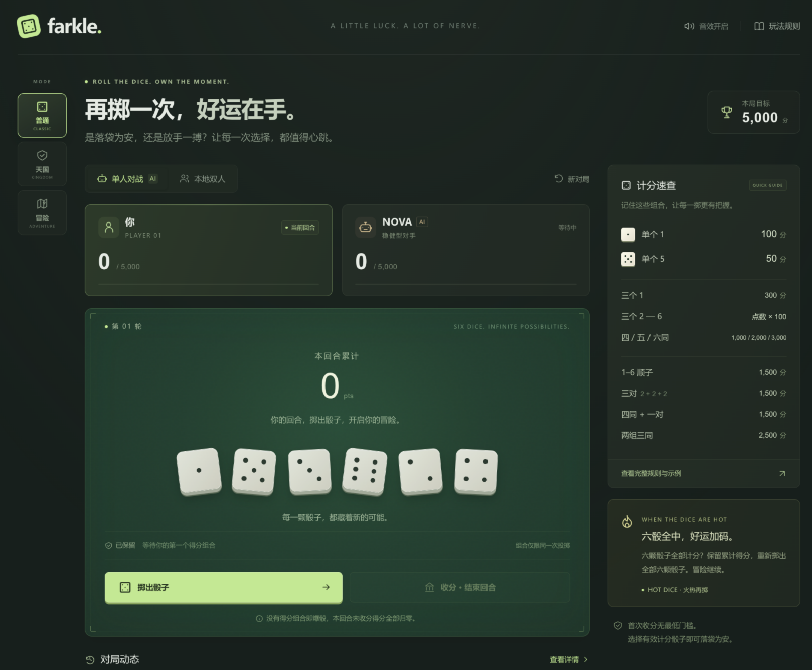

# Farkle · 再掷一次，好运在手

基于 Vue 3、Vite 的中文六骰游戏。独立项目，无后端和 API 密钥要求，运行后可离线游玩。



## To do list

- [x] 基础游戏框架
- [ ] 特殊骰子（天国拯救骰子）
- [ ] 冒险模式
- [ ] 接入API 与 AI对战

## 开始

环境：Node.js 20.19+ 或 22.12+。

```bash
cd Farkle
npm install --include=dev
npm run dev
```

打开终端显示的地址（默认 http://localhost:5173）。

```bash
npm test          # 规则、回合和 90 场 AI 自动对局验证
npm run build    # 生产构建，输出 dist/
npm run preview  # 预览构建结果
```

## 玩法与功能

- **单人模式**：与 NOVA AI 对战。提供稳健、均衡、冒险三种风格，AI 根据剩余骰数的精确爆骰概率、累计得分和双方分差作出决策。AI 只能读取已经投掷的骰子，不读取或修改未来随机结果。
- **本地双人**：两位玩家共用设备轮流操作；可自定义玩家名称，回合结束后点击交接按钮。
- 可自由选择骰子，或用「帮我选」选出当前最高分组合；非法组合会提示，不能收分或继续投掷。
- 新对局可自定义 1,000–100,000 分的获胜目标（每次递增 500 分），提供 5,000、10,000 和 15,000 分快捷选项；首次收分门槛可设为 0–10,000 分（每次递增 50 分，0 为无限制）；支持 Hot Dice、Farkle、目标分数最终回合及同分平局。
- 计分速查、完整规则、对局动态、可选合成音效、移动端布局、键盘操作与减少动态效果支持。
- 自动保存当前对局及自定义获胜目标至浏览器 localStorage，刷新后继续；浏览器禁止存储时仍可正常游玩。当前版本仅保存最近一场对局。

## 规则来源

制作前检索并下载核对了发行商原始说明：

- [PlayMonster Farkle 规则 PDF](https://www.playmonster.com/wp-content/uploads/2018/06/Farkle-Rules.pdf)
  计分及回合逻辑遵循该说明。为适配本地游戏，本作固定玩家一先手，同分视为平局；不包含额外家规惩罚。各版本 Farkle 计分可能不同，本作**三个 1 为 300 分，三对为 1500 分**。

| 组合                         |                        得分 |
| ---------------------------- | --------------------------: |
| 单个 1 / 单个 5              |                    100 / 50 |
| 三个 1                       |                         300 |
| 三个 2 / 3 / 4 / 5 / 6       | 200 / 300 / 400 / 500 / 600 |
| 四同 / 五同 / 六同           |       1,000 / 2,000 / 3,000 |
| 1–6 顺子 / 三对 / 四同加一对 |                       1,500 |
| 两组三同                     |                       2,500 |

1. 每回合从六颗骰子开始，每次投掷后必须选出至少一颗可计分骰子。
2. 首次收分门槛可在开局时设置（默认 500 分，设为 0 时无限制）；达到门槛后可随时收下有效得分。
3. 继续掷未保留的骰子；如果六颗全部计分，可带着累计得分重新掷全部六颗。
4. 新掷出的骰子没有任何计分组合即 Farkle，本回合未收分得分归零，已收分的总分不受影响。
5. 得分组合只能来自同一次投掷，不允许跨次拼接。
6. 有玩家收分后达到本局自定义目标分数（默认 10,000 分），对手再进行最后一回合。最后总分较高者获胜。
